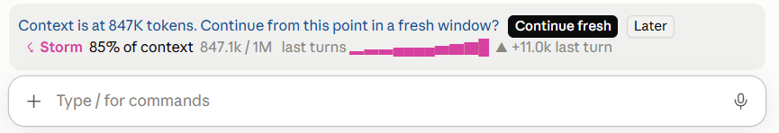
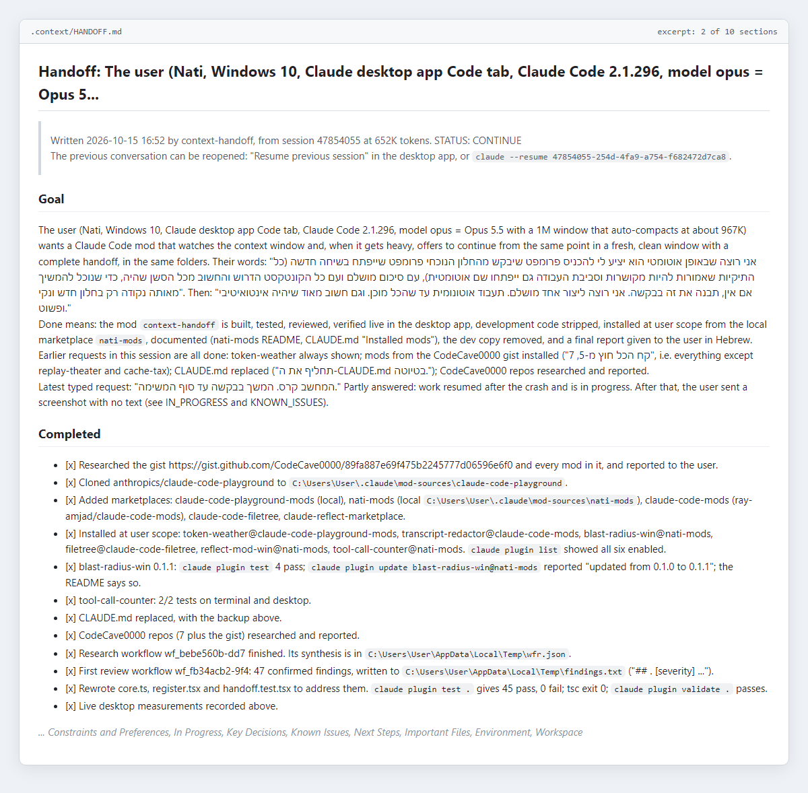

# context-handoff

When the context grows heavy, offers to continue from the same point in a fresh window.

## How it works

1. **The offer.** After each turn it compares the context with a line: 500K tokens, or 85% of the auto-compact point if that is lower. A band above the prompt offers **Continue fresh** or **Later**. Later moves the line on by 150K. One last offer comes at 95% of the auto-compact point.
2. **The handoff.** On accept, the model writes the handoff through a fork of the session's own transcript: it sees everything, reuses the prompt cache and runs no tools. Sections: Goal, Constraints and Preferences, Completed, In Progress, Key Decisions, Known Issues, Next Steps, Important Files, Environment, Workspace. It is saved to `<project>/.context/HANDOFF.md`; the previous file goes to `.context/handoff-archive/`.
3. **The switch.** The mod runs `/clear` once no turn is running. The folder, model, permissions and additional folders stay; the old conversation stays under "Resume previous session" (`claude --resume <id>` in the terminal).
4. **The pickup.** The new conversation gets the handoff attached to its first message, and a prompt sent as you: carry on with the next step, or summarize and wait if the handoff says so.

The start of a handoff it wrote, about the session that built this mod:

Why this instead of `/compact`: see [Why not just /compact?](../README.md#why-not-just-compact).

A handoff you saved with `/handoff write` and never used is offered in the next new conversation in the same folder, for three days, and taken only once.

## Commands

| Command | Does |
| --- | --- |
| `/handoff` | Continue now in a fresh window |
| `/handoff write` | Only save the handoff and stay in the conversation |
| `/handoff resume` | Continue from a handoff waiting in this folder |
| `/handoff at 300k` | Offer from 300K tokens (also `at 85%`, `at auto`) |
| `/handoff off` / `on` | Turn the automatic offers off or on |
| `/handoff status` | Where things stand |
| `/handoff lang he\|en\|auto` | Interface language. `auto` follows what you type: Hebrew once you write Hebrew, otherwise English |

## What it touches

From `claude plugin validate`: it reads and writes `.context/HANDOFF.md` and `.context/handoff-archive/` in the project, reads settings (for the additional folders), keeps a small record in its own plugin store, runs `/clear`, and sends one prompt as you after the switch. Each handoff costs one model call on your plan (two if the first answer is cut short). No network access of its own, no processes.

## Notes

- In the desktop app the band is the only feedback: the app does not show toasts or log lines from mods.
- The band hides while Claude is working, and its buttons have no number hotkeys, so typing "1" to answer Claude never presses one.
- A message you type while the handoff is being written cancels the switch; the offer comes back later.
- In a git worktree, the handoff goes to the main checkout's `.context/`.

## Tests

`claude plugin test .` runs 75 tests against the engine's test kit, on both the terminal and desktop surfaces. Verified live in the desktop app: the band, and a fork over a 650K-token session that produced a complete 24KB handoff.
